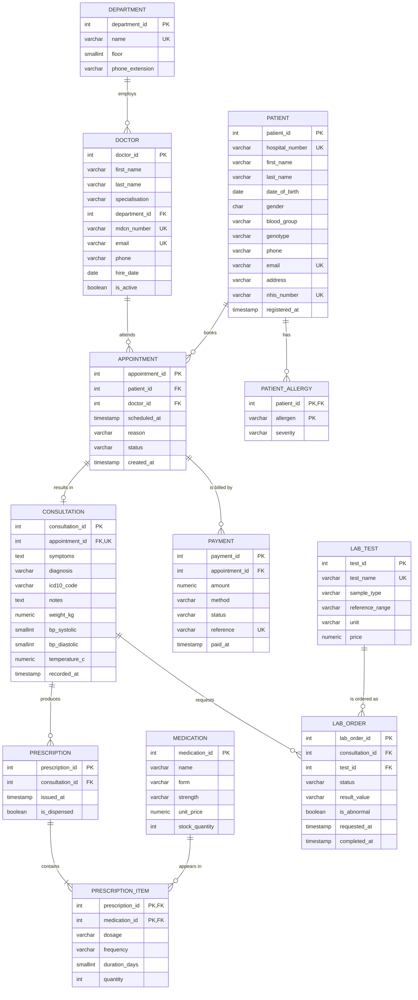

# ER Diagram — CareBridge Specialist Clinic

GitHub renders this diagram automatically. To export it as an image, paste the code block into https://mermaid.live and download a PNG.

## Relationship summary

| Relationship | Cardinality | Business rule |
|---|---|---|
| Department – Doctor | 1 : N | Every doctor belongs to one department; a department can have many doctors. |
| Patient – Appointment | 1 : N | A patient can book many appointments over time. |
| Doctor – Appointment | 1 : N | A doctor sees many patients, but only one per time slot. |
| Appointment – Consultation | 1 : 0..1 | Only appointments that actually happen produce a consultation record. |
| Appointment – Payment | 1 : N | A bill can have several payment attempts (e.g. a failed transfer, then a successful one). |
| Consultation – Prescription | 1 : N | A consultation may produce zero or more prescriptions. |
| Prescription – Medication | M : N | Resolved through PRESCRIPTION_ITEM, which stores dosage and quantity. |
| Consultation – Lab Test | M : N | Resolved through LAB_ORDER, which stores status and result. |
| Patient – Allergy | 1 : N | Allergies are a multi-valued attribute, stored in their own table. |
