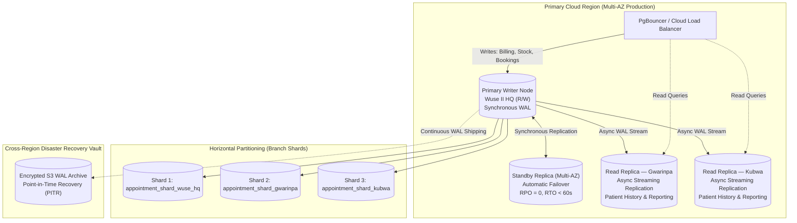

# Portfolio 5 — Distributed and Cloud Database Architecture

## Overview

This module designs and demonstrates a distributed and cloud database architecture for **CareBridge Specialist Clinic** as it scales from a single outpatient clinic in **Wuse II (HQ)** to satellite branches in **Gwarinpa** and **Kubwa** across Abuja, with cloud disaster recovery hosted on AWS (`af-south-1` Primary / `eu-west-1` DR).

## Files in this folder

| File | Purpose |
|---|---|
| `distributed-sharding-replication.sql` | Implements declarative horizontal partitioning (`PARTITION BY LIST (branch_code)`), verifies partition pruning via `EXPLAIN`, and configures logical replication publications (`CREATE PUBLICATION`) |
| `screenshots/` | Execution evidence of physical shard placement (`tableoid::regclass`), single-shard partition pruning, and replication publication metadata |

## 1. Distributed Cloud Architecture Diagram

## 2. Replication Strategy

CareBridge uses a **Hybrid Synchronous + Asynchronous Replication** topology:

1. **Synchronous Multi-AZ Standby (High Availability for Clinical & Financial Writes):**
   - The Primary node replicates Write-Ahead Log (`WAL`) records synchronously (`synchronous_commit = on`) to a hot standby in a second Availability Zone.
   - Guarantees **Zero Data Loss ($\text{RPO} = 0$)** for payments, prescriptions, and allergy records, with automated failover ($\text{RTO} < 60\text{ seconds}$).
2. **Asynchronous Read Replicas & Logical Publications (`carebridge_hq_publication`):**
   - Catalogue tables (`department`, `doctor`, `medication`, `lab_test`) are published via PostgreSQL Logical Replication (`CREATE PUBLICATION carebridge_hq_publication`) to regional branch replicas in Gwarinpa and Kubwa.
   - Offloads heavy analytical queries (Portfolio 2 departmental revenue reports and patient medical history lookups) from the primary writer node.

## 3. Horizontal Sharding & Partition Pruning (`distributed-sharding-replication.sql`)

High-volume operational tables (`distributed_appointment`) are horizontally partitioned by `branch_code` (`PARTITION BY LIST (branch_code)`):

- `appointment_shard_wuse_hq` (`FOR VALUES IN ('WUSE_HQ')`)
- `appointment_shard_gwarinpa` (`FOR VALUES IN ('GWARINPA')`)
- `appointment_shard_kubwa` (`FOR VALUES IN ('KUBWA')`)

### Evidence of Partition Pruning
When the Gwarinpa front desk queries `WHERE branch_code = 'GWARINPA'`, PostgreSQL's query planner uses **partition pruning** (`EXPLAIN (COSTS OFF)`) to scan *only* `appointment_shard_gwarinpa`, completely skipping the Wuse HQ and Kubwa shards.

## 4. CAP Theorem, Consistency & Availability Trade-Offs in Healthcare

In a distributed healthcare database, different clinical subsystems require different positions on the **CAP / PACELC spectrum**:

| Clinical Subsystem | Consistency Model | CAP / PACELC Justification |
|---|---|---|
| **Patient Allergies, Prescriptions & Drug Stock** | **Strong Consistency (CP / PC-EC)** | A stale read on `patient_allergy` (e.g. missing a severe Penicillin allergy) or double-dispensing out-of-stock medication poses life-threatening clinical risk. Writes and critical reads route to the synchronous Primary/Standby pair. |
| **Appointment Slot Booking** | **Strong Consistency (CP)** | Enforces `uq_doctor_slot` globally so two branches cannot book the same specialist into the same time slot. |
| **Historical Lab Reports & Management Dashboards** | **Eventual Consistency (AP / PA-EL)** | A 100–300 ms asynchronous replication lag on historical visits or monthly revenue dashboards is clinically harmless and keeps branch read queries fast even during network jitter. |

## Reflection

Designing the distributed architecture for CareBridge Clinic highlighted that healthcare systems cannot apply a single blanket consistency policy across all tables. By combining declarative horizontal partitioning (`PARTITION BY LIST`) for branch-level query locality with synchronous replication for safety-critical clinical writes and logical/asynchronous replication for read-heavy catalogues, the clinic achieves high availability without compromising patient safety.